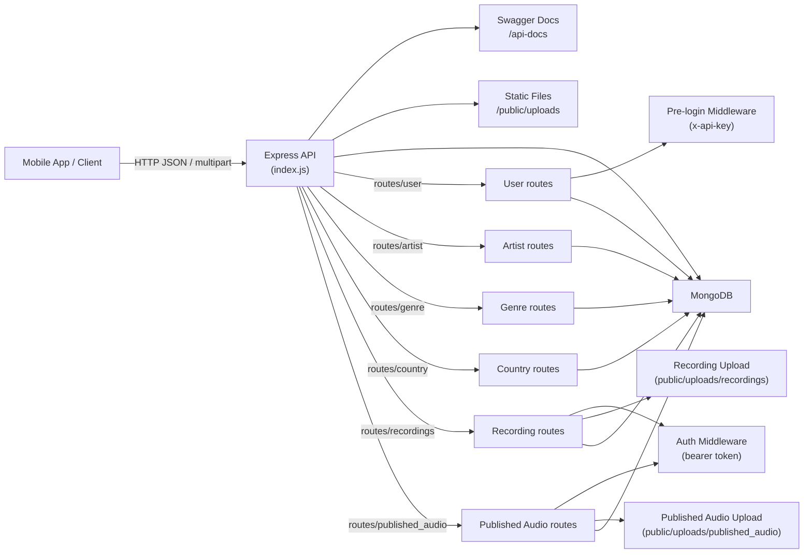

# Bondfire API Architecture

## Overview
The Bondfire API is a Node.js + Express backend for a mobile application. It provides user onboarding, audio upload and publishing, preference management, and catalog access for artists, genres, and countries.

## Core responsibilities
- Accept REST API requests from mobile or web clients
- Authenticate users and authorize private actions
- Upload and serve audio/image assets from local storage
- Persist user, content, and metadata in MongoDB
- Document endpoints using Swagger UI

## High-level architecture

## Components

### `index.js`
- Loads environment variables
- Connects to MongoDB
- Configures CORS and request logging
- Serves static uploads from `public/uploads`
- Mounts route groups and Swagger UI
- Starts the server

### Route groups
- `routes/user.js`
  - User onboarding, verification, login, password reset, preferences, profile updates, guest user support
- `routes/artist.js`
  - Artist catalog retrieval
- `routes/genre.js`
  - Genre catalog retrieval
- `routes/country.js`
  - Country list retrieval
- `routes/recordingRoutes.js`
  - Upload/list/delete user recordings
- `routes/publishedAudio.js`
  - Publish audio tracks with cover images

### Middleware
- `middleware/auth.js`
  - Verifies bearer tokens via the `VerificationToken` collection
- `middleware/preLoginAuth.js`
  - Protects pre-login endpoints using `x-api-key`
- `middleware/uploadRecording.js`
  - Stores audio recording uploads under `public/uploads/recordings`
- `middleware/uploadPublishedAudio.js`
  - Stores published audio files and images under `public/uploads/published_audio`

### Data models
- `User` — user accounts, profile data, language, device info, status fields
- `UserPreference` — saved genre/artist/country preferences for each user
- `VerificationToken` — short-lived auth tokens used for protected requests
- `MobileOtp` and `MobileOtpSendLog` — mobile OTP verification and rate limiting
- `Recording` — user-uploaded audio recordings
- `PublishedAudio` — published audio tracks with audio and image metadata
- `Genre`, `Artist`, `Country` — content catalogs used by the client

## What the application supports
- User registration and verification flows
- Email- or token-based authentication for protected APIs
- Phone OTP sending and verification
- Guest user registration
- User preference selection for genres, artists, and countries
- Audio recording upload and management
- Published audio upload with image cover assets
- Catalog access for artists, genres, and countries
- API discovery via Swagger UI at `/api-docs`

## Notes
- Uploads are stored locally and served from `/uploads`
- Authentication is currently token-based using stored verification tokens rather than JWT
- The API is structured for a mobile-first client with a mix of protected and pre-login endpoints
